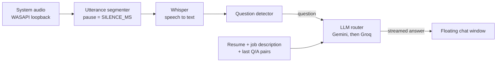

# Nexa: AI Interview Copilot

Nexa is a Windows desktop app that lives in a small floating window. It listens to your computer's system audio, detects the questions the interviewer asks, and streams a natural, medium-length answer written from **your resume** and **the job description**.

> **One audio input → one detected question → one LLM answer → floating chat window.**

---

## Contents

- [Features](#features)
- [How it works](#how-it-works)
- [Quick start](#quick-start)
- [Using Nexa](#using-nexa)
- [Configuration](#configuration)
- [Build Nexa.exe](#build-nexaexe)
- [Troubleshooting](#troubleshooting)
- [Development](#development)
- [Project layout](#project-layout)
- [Privacy and data handling](#privacy-and-data-handling)
- [Responsible use](#responsible-use)

---

## Features

- **Floating chat window.** Small, frameless, draggable by its title bar, always on top (you can turn this off), with minimize and close buttons.
- **Hands-free flow.** Press START once. Questions are detected and answered automatically until you press STOP.
- **Personalised answers.** Upload your resume (PDF, DOCX, TXT or pasted text) and paste the job description. Answers are written in first person, about 90 to 130 words, and the prompt forbids inventing employers, projects or numbers.
- **Follow-up aware.** The last few question and answer pairs are kept in memory, so "why?" and "can you elaborate?" work.
- **Smart question detection.** Real questions and requests ("Tell me about…", "Walk me through…", "Can you…") are answered. Small talk and statements are ignored. A question split by a pause is merged back together, and a repeated question within 15 seconds is not answered twice.
- **Streaming answers.** Text appears as it is generated.
- **LLM fallback.** Gemini is tried first and Groq takes over if Gemini fails. A model that fails is skipped for a while, so later questions do not wait on a dead model.
- **Local speech recognition.** Whisper (faster-whisper) runs on your machine. It falls back to CPU automatically if CUDA libraries are missing.
- **No history.** Nothing is saved after STOP. Conversation memory lives in RAM only.

---

## How it works



1. **Upload resume and job description.** Resume as PDF, DOCX or TXT (up to 5 MB), or paste its text. Paste the job description.
2. **Click START.** Whisper loads, then Nexa begins capturing what your default speakers or headphones are playing.
3. **Speech to text.** Audio is cut into utterances at pauses and transcribed. The detector decides whether the interviewer asked a question. An unfinished question is held for up to 2.5 seconds and merged with what follows.
4. **Answer generation.** The question, resume, job description and recent conversation go to Gemini. If it fails, Groq answers instead. If a provider fails halfway through an answer, the partial text is cleared and the next provider starts over.
5. **Floating chat.** The answer streams into the window. Questions are answered one at a time. If the interviewer keeps talking, up to 4 questions wait in a queue, and the oldest is dropped if it overflows.
6. **Click STOP.** Audio capture stops and the conversation memory is wiped. Your resume and job description stay in memory until you close the app, so you can START again without uploading them.

---

## Quick start

**Requirements:** Windows 10 or 11, Python 3.10+, Node.js 18+, and at least one API key (Gemini and/or Groq).

```bat
setup.bat      :: creates .venv, installs dependencies, builds the UI (run once)
```

Open the new `.env` file and add a key:

```env
GEMINI_API_KEY=your_key_here
GROQ_API_KEY=your_key_here
```

Then start the app:

```bat
run.bat
```

The first START downloads the Whisper model (a one-time download, so internet is needed once). The default `base` model is roughly 150 MB.

---

## Using Nexa

1. Drop your resume into the window, or click "Or paste resume text".
2. Paste the job description.
3. Click **START**. The status pill shows *Starting*, then *Listening*.
4. Play or join the interview. When a question is detected it appears in the chat with the answer streaming below it. The footer shows the last thing Nexa heard, which helps when checking that audio is being picked up.
5. Click **STOP** when you are done. The chat and conversation memory are cleared.

Tips:

- Use the small dot button in the title bar to switch always-on-top on or off.
- To use a different resume or job description, press STOP first. They cannot be changed while a session is running.
- If you change your default speakers or headphones during a session, press STOP and START again.

---

## Configuration

Settings are read from `.env` (copy `.env.example` to create it). All settings except the API keys are optional.

| Variable | Default | Description |
|---|---|---|
| `GEMINI_API_KEY` | none | Gemini API key. Gemini is tried first. |
| `GROQ_API_KEY` | none | Groq API key. Used as the fallback. |
| `GEMINI_MODELS` | `gemini-3.5-flash-lite,gemini-flash-latest` | Comma-separated, tried in order. |
| `GROQ_MODELS` | `llama-3.3-70b-versatile,llama-3.1-8b-instant` | Comma-separated, tried in order. |
| `WHISPER_MODEL` | `base` | `tiny` or `base` are faster, `small` or `medium` are more accurate. A `.en` suffix (for example `small.en`) is English-only. |
| `WHISPER_DEVICE` | `auto` | `auto`, `cpu` or `cuda`. |
| `WHISPER_COMPUTE_TYPE` | `auto` | `auto`, `int8` or `float16`. |
| `WHISPER_LANGUAGE` | empty (auto-detect) | For example `en`. Leave empty for automatic detection with a multilingual model. |
| `SILENCE_MS` | `750` | Pause length that ends the interviewer's sentence. |
| `HISTORY_TURNS` | `6` | Number of previous question and answer pairs kept for follow-ups. |

Limits: resume text is capped at 12,000 characters and the job description at 8,000.

If an answer fails with a 404, a model name has probably been retired. Update `GEMINI_MODELS` or `GROQ_MODELS`. Dead models are skipped automatically after the first failure.

---

## Build Nexa.exe

Run `setup.bat` once, then:

```bat
build_exe.bat      :: output: dist\Nexa\Nexa.exe
```

To use or share the build:

1. Copy the **whole `dist\Nexa` folder**, not only `Nexa.exe`.
2. In that folder, rename `.env.example` to `.env` and add your API key.
3. Double-click `Nexa.exe`.

Notes:

- Your `.env` is never packed into the build, so your keys are not shared when you hand the folder to someone else. Each user adds their own.
- The Whisper model downloads on the first START, so internet is needed once.
- The target PC needs the **Microsoft Edge WebView2 Runtime**. It is already present on most Windows 10 and 11 systems.
- The `.exe` has no console window. Errors and status messages go to `nexa.log` next to `Nexa.exe`. The log never contains questions or answers.
- Some antivirus tools flag new, unsigned executables. A folder build triggers this less often than a single-file build.

---

## Troubleshooting

| Problem | What to try |
|---|---|
| "No LLM key found" | Add `GEMINI_API_KEY` or `GROQ_API_KEY` to `.env` (next to `Nexa.exe` for the built app) and restart. |
| Nothing is detected | Nexa records the **default output device**. Make sure the call app plays through the same speakers or headphones that Windows uses by default. The footer should show "Heard: …" when audio is picked up. |
| Questions are missed or arrive late | Lower `SILENCE_MS` (for example 600) for faster response. |
| Long questions get cut in half | Raise `SILENCE_MS` (for example 1000). |
| Transcription is slow on CPU | Use `WHISPER_MODEL=tiny` or `base`. The log warns when transcription falls behind real time. |
| Transcription is inaccurate | Use `WHISPER_MODEL=small` or `medium` (a GPU is recommended for `medium`). |
| Answer fails with 404 | A model was retired. Update `GEMINI_MODELS` or `GROQ_MODELS`. |
| CUDA or cuDNN error | Nexa retries on CPU automatically. You can also set `WHISPER_DEVICE=cpu`. |
| Window is blank when running the `.exe` | Install the Microsoft Edge WebView2 Runtime. |
| "Frontend not built" | Run `cd frontend && npm install && npm run build`, or run `setup.bat` again. |
| Audio capture fails to start | Loopback capture works on Windows only. Check that an output device is enabled in Windows Sound settings. |

---

## Development

```bat
.venv\Scripts\activate
python -m backend.main          :: API on http://127.0.0.1:8765
cd frontend && npm run dev      :: UI on http://localhost:5173 (proxies /api and /ws)
python desktop.py --dev         :: desktop window pointing at the Vite dev server
pytest                          :: backend tests (no API keys needed)
```

The local API exposes `GET /api/status`, `POST /api/context`, `POST /api/start`, `POST /api/stop` and a `/ws` WebSocket for live events.

**Stack**

| Layer | Technology |
|---|---|
| Desktop shell | Python + PyWebView (frameless, always on top) |
| Frontend | React + TypeScript (Vite) |
| Backend | Python + FastAPI (REST + WebSocket) |
| Audio capture | Windows WASAPI loopback (PyAudioWPatch) |
| Speech to text | Whisper via faster-whisper (local) |
| LLM | Gemini with Groq fallback (streaming) |
| Packaging | PyInstaller |

---

## Project layout

```
desktop.py                PyWebView shell, logging, local server start-up
nexa.spec                 PyInstaller build definition
build_exe.bat             one-step .exe build
setup.bat / run.bat       install and launch scripts
backend/
  main.py                 FastAPI app and API routes
  pipeline.py             audio -> utterance -> Whisper -> question -> LLM -> events
  audio_capture.py        WASAPI loopback and resampling to 16 kHz mono
  segmenter.py            pause-based utterance segmentation
  stt.py                  faster-whisper wrapper, CPU fallback, hallucination filter
  question_detector.py    question detection, fragment merging, de-duplication
  llm.py                  Gemini -> Groq streaming router with cool-downs
  session.py              in-memory resume/JD, Q/A context, prompt builder
  documents.py            PDF / DOCX / TXT text extraction
  config.py               settings and path handling (source and .exe)
  hub.py                  WebSocket event broadcast
frontend/src/             React UI: SetupView, ChatView, useNexa hook
tests/                    pytest suite
```

---

## Privacy and data handling

- **Audio** is transcribed locally by Whisper and is never uploaded.
- **Sent to Gemini or Groq:** the transcribed question, your resume text, the job description and the last few question and answer pairs.
- **Not stored:** questions and answers live in RAM only and are wiped on STOP. There is no chat or answer history on disk.
- **On disk:** the downloaded Whisper model, your `.env`, and (in the built app) `nexa.log` containing status and error messages only.
- **Local API:** it binds to `127.0.0.1` and rejects requests from other websites, so web pages in your browser cannot control it.
- **Never share your `.env`.** It contains your API keys. If it ever leaves your machine, regenerate the keys.

---

## Responsible use

Many interviewers and employers prohibit AI assistance during live interviews, and some platforms can detect it. Check the rules for your interview before you use Nexa.

Nexa is also a good fit for **mock interviews**. Play a practice interview or a recorded one through your speakers and rehearse your answers alongside it.